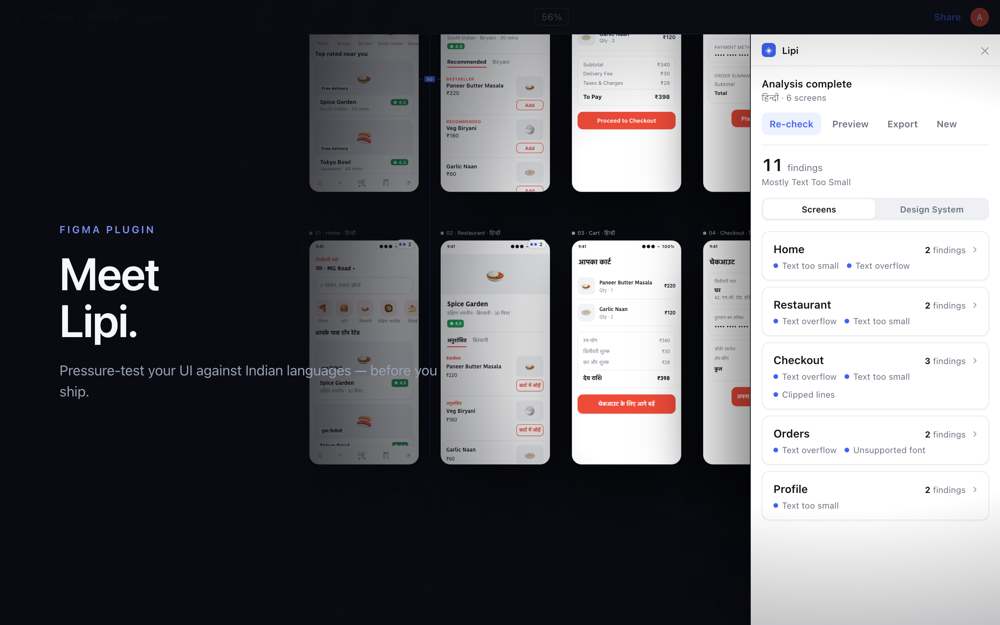
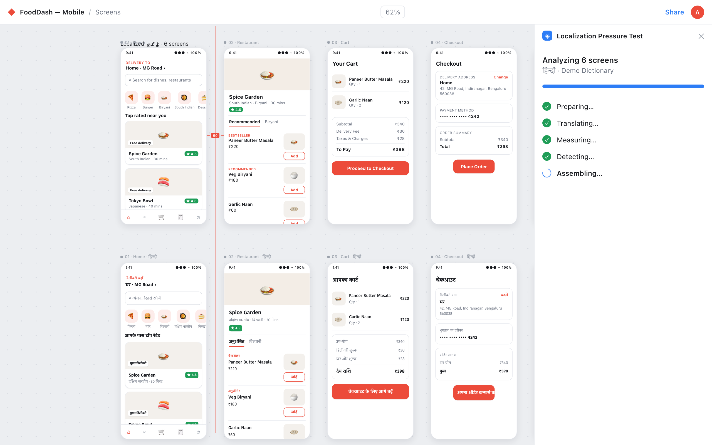
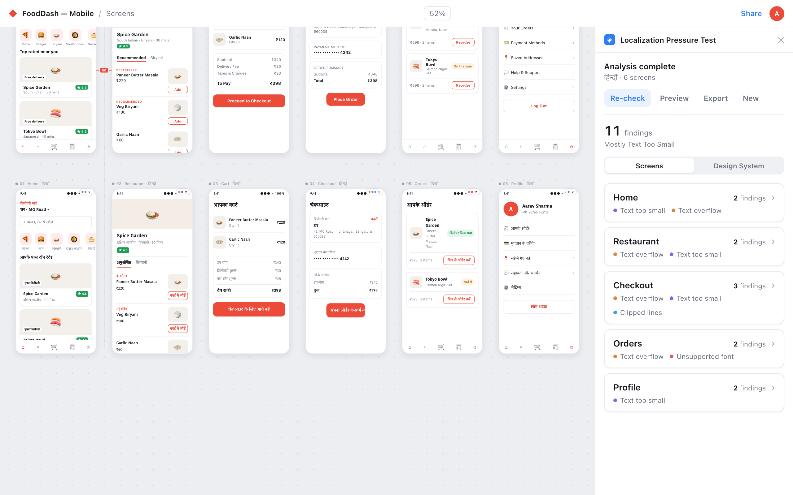
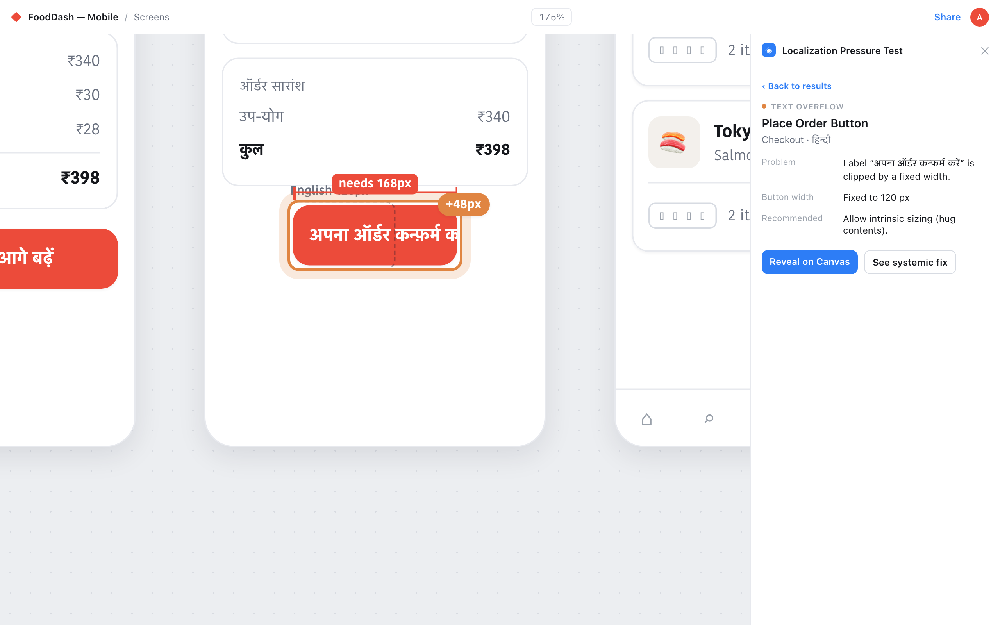
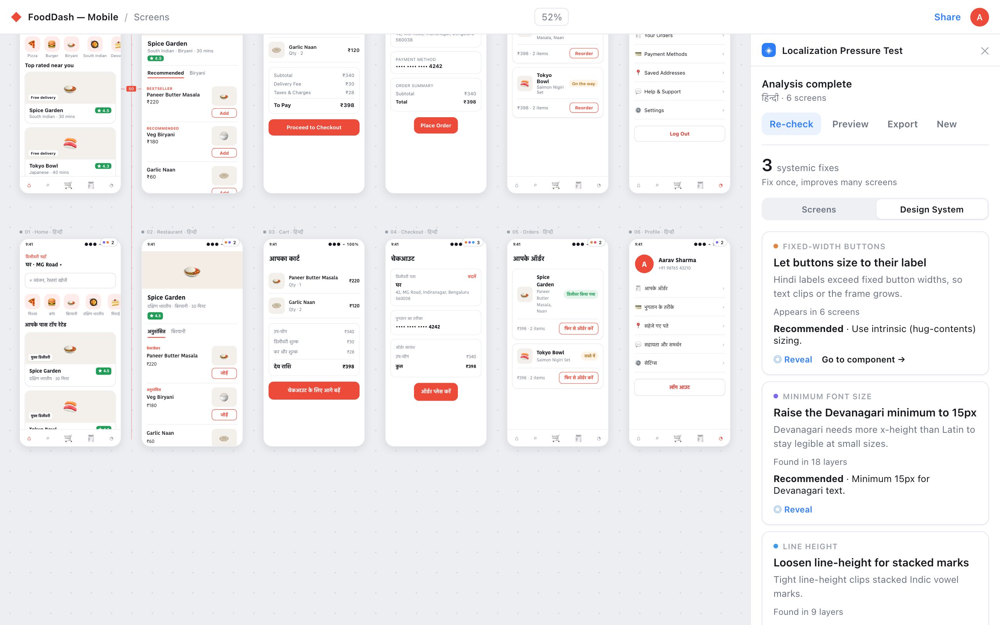

# Lipi

**A Figma plugin that pressure-tests your UI against localized copy** — generate a
Hindi or Tamil variant of the selected screens, see exactly where translated text
breaks the layout, reveal each problem on the canvas, and export the localized copies.
*(The plugin ships in Figma under its functional name, "Localization Pressure Test".)*

<p align="center">
  
</p>

> **Scope, stated honestly:** this is a *localization-pressure concept for Indic
> languages* (Hindi + Tamil today). It's a design-and-engineering study, not a
> production localization pipeline — see [Limitations](#limitations).

<p align="center">
  
  
  
  
</p>

## What it does

1. **Preview** — select English frames and the plugin swaps them, in place, for a
   translated variant so you see the localized screens on your own canvas
   (reversible — your originals are untouched).
2. **Identify** — a delta engine clones + translates + re-measures each screen and
   flags where localization creates *pressure*: text overflow, text below a legible
   size, clipped lines, and unsupported fonts.
3. **Reveal** — every finding highlights its layer(s) directly on the canvas.
4. **Fix at the source** — a Design System view groups recurring problems into
   one recommendation ("one update improves N screens") with a jump to the
   component.
5. **Export** — drop permanent localized copies into a titled section, e.g.
   `Home (Hindi)`.

## Two connected views

- **Screens** — triage, screen by screen: each screen lists its problems grouped by
  type (`Text too small (5)`) with the affected layers behind disclosure.
- **Design System** — the recurring fixes, deduplicated across screens, each linking
  back to where it appears.

The two views cross-link so a per-screen problem can jump to its systemic fix, and a
systemic fix can show where it occurs.

## How it's built

- **React + TypeScript + Vite**, single-file bundle via `vite-plugin-singlefile`.
- **Two-context Figma architecture**: a sandbox (`src/main`, the `figma` API, no
  network) that runs the clone → translate → measure → analyze pipeline, and a UI
  iframe (`src/ui`, React, network) that renders results. A typed message contract
  (`src/shared/messages.ts`) keeps the two sides in sync.
- **Analysis is a stable seam**: any detector produces `Issue[]`; `assembleReport`
  decorates + aggregates into a `Report`; the UI is a pure presentation layer over
  that report. Regression scripts in `scripts/` cover the engine.
- **Translation providers**: a built-in, offline **Demo** provider and a
  **Google Translate** provider (real translations, requires an API key).
  - The **Demo** provider ships a **curated bilingual dictionary** — 73 real
    Hindi and 73 real Tamil translations (keys matched across both languages),
    covering navigation, auth, actions/CTAs, content, commerce, and a
    transit/journey slice (`DEMO_DICT` in `src/ui/translate/provider.ts`). Any
    string it doesn't cover falls back to deterministic, script-correct
    pseudo-text — so the demo shows *genuine* localization with no API key,
    and can never render tofu. See [`docs/DEMO_CONTENT.md`](docs/DEMO_CONTENT.md)
    for the exact vocabulary and how to build demo screens that localize for real.

## Run it locally

```bash
npm install
npm run build          # emits dist/code.js + dist/index.html
npm run typecheck
```

In Figma desktop: **Plugins → Development → Import plugin from manifest…** and pick
`manifest.json`. Select some English frames and run the plugin.

## Limitations

- **Languages:** Hindi + Tamil only. The big text-expansion cases (German/French)
  and RTL (Arabic/Hebrew) aren't covered yet.
- **Translation source:** it translates the English text on the canvas, not a real
  i18n string catalog. Demo mode uses a curated real-translation dictionary (see
  above) with pseudo-text as a fallback for uncovered strings; full, arbitrary
  translation needs a Google Translate key. Tamil entries should get a
  native-speaker review before public use.
- **Detection is heuristic** (size thresholds, clone-and-reflow geometry) and hasn't
  been hardened against every real-world file.

## License

Personal / portfolio project.
